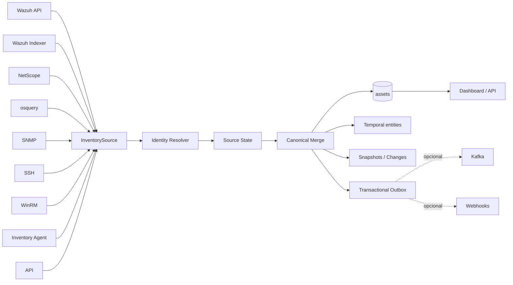

# Asset Core — arquitetura multifuente

## 1. Objetivo

O Asset Core é a camada canônica de identidade, normalização, histórico e integração do Inventory.

Ele remove a dependência conceitual do Wazuh como fonte única.

---

## 2. Arquitetura



---

## 3. Contrato InventorySource

Cada observação inclui:

- source;
- external_id;
- raw_data;
- normalized;
- observed_at;
- confidence quando aplicável.

Cada fonte preserva seu estado sem apagar a visão das demais.

---

## 4. Identidade

Sinais fortes:

- external-id estável da fonte;
- serial;
- machine-id;
- cloud-id;
- Wazuh agent id;
- MAC não ambíguo.

Hostname e IP são atributos mutáveis.

Conflito de identidade é persistido em vez de realizar merge silencioso.

---

## 5. Estado canônico

O merge considera:

- precedência por campo;
- confiança;
- recência;
- origem.

O ativo canônico não perde a proveniência dos valores.

---

## 6. Entidades temporais

Tabelas:

- asset_addresses;
- asset_interfaces;
- asset_hardware;
- asset_software;
- asset_processes;
- asset_services;
- asset_ports.

Campos temporais:

- entity_key;
- first_seen;
- last_seen;
- active;
- valid_to;
- source.

---

## 7. Histórico

São mantidos:

- observações;
- snapshots;
- mudanças;
- conflitos.

Isso permite responder:

- quando o IP mudou;
- quando uma porta apareceu;
- quando software foi removido;
- qual fonte observou um estado;
- quando uma divergência começou.

---

## 8. Wazuh opcional

```dotenv
WAZUH_ENABLED=false
```

O Asset Core continua operando com outras fontes.

---

## 9. Eventos

Evento externo principal:

```text
asset.snapshot.v1
```

A publicação usa outbox transacional.

Kafka e webhooks são consumidores opcionais do outbox.

---

## 10. API

Principais operações:

```text
GET  /api/v1/assets
GET  /api/v1/assets/<asset_uuid>
GET  /api/v1/sources
POST /api/v1/assets/observations
POST /api/v1/sources/sync
```

Contrato completo: [openapi.yaml](openapi.yaml).

---

## 11. Compatibilidade

`HostInventory` permanece durante a transição.

Variáveis relevantes:

```dotenv
ASSET_BACKFILL_LEGACY=true
LEGACY_HOST_MIRROR=false
```

Novos componentes devem preferir `Asset`.

---

## 12. Documentação complementar

- [IMPLEMENTACAO_COMPLETA_020.md](IMPLEMENTACAO_COMPLETA_020.md)
- [REFATORACAO_FEATURES.md](REFATORACAO_FEATURES.md)
- [OPERACAO_REFATORADA.md](OPERACAO_REFATORADA.md)
