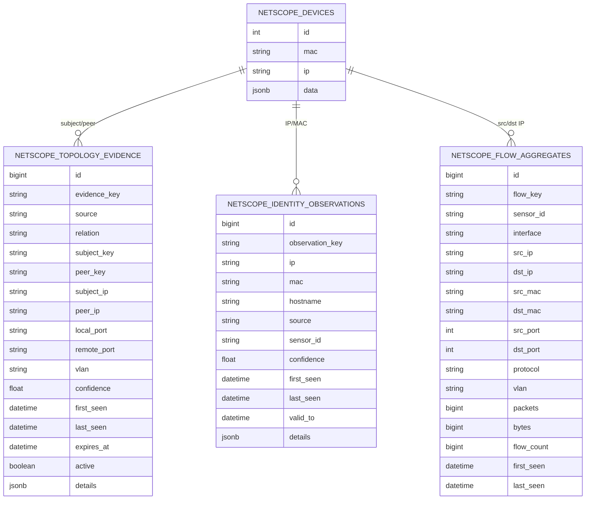

# NetScope — modelo de dados da refatoração

## 1. Visão geral

A topologia deixou de depender apenas do JSON embutido em `netscope_devices.data`.

A refatoração adiciona tabelas temporais de evidência, fluxo e identidade.



---

## 2. netscope_devices

Continua sendo a representação principal do dispositivo no NetScope.

Campos estruturais:

- id;
- mac;
- ip;
- hostname;
- deleted;
- last_seen;
- data JSONB.

O JSON pode incluir:

- uid;
- status;
- missed_scans;
- parent_id;
- parent_inferred;
- parent_confidence;
- parent_relation;
- parent_evidence;
- inferred_roles;
- documentação do ativo.

---

## 3. netscope_topology_evidence

### Objetivo

Persistir a razão de uma inferência.

### evidence_key

Hash estável dos campos que identificam a observação.

Evita inserir a mesma evidência repetidamente.

### source

Exemplos:

- passive;
- arp;
- ethernet;
- lldp;
- cdp;
- snmp-fdb.

### relation

Exemplos:

- arp-presence;
- l2-peer-observed;
- l2-next-hop;
- physical-neighbor;
- fdb-learned;
- fdb-access-candidate.

### confidence

Faixa 0..1.

É sinal de qualidade da evidência, não probabilidade estatística calibrada.

### expiração

Evidências temporais têm `expires_at`.

Registros expirados são mantidos/inativados conforme política para impedir que uma observação antiga continue influenciando o Inferir.

---

## 4. netscope_flow_aggregates

Não armazena PCAP.

Cada linha agrega uma janela por combinação aproximada de:

- sensor;
- bucket temporal;
- src IP;
- dst IP;
- src port;
- dst port;
- protocolo;
- VLAN.

Permite calcular centralidade sem manter payload.

---

## 5. netscope_identity_observations

Mantém associação temporal IP↔MAC/hostname.

Fontes:

- ARP;
- Ethernet;
- DHCPACK;
- next-hop;
- extensível para novas fontes.

### Regras

- `observation_key` deduplica;
- `last_seen` atualiza recorrência;
- `valid_to` suporta lease DHCP;
- `confidence` controla promoção;
- conflito de MAC por IP impede reconciliação automática.

---

## 6. Retenção

Configuração:

```json
{
  "flow_retention_hours": 24,
  "identity_retention_days": 30,
  "evidence_ttl_seconds": 1800
}
```

O worker executa limpeza periódica.

---

## 7. Integridade

### MAC

`netscope_devices.mac` permanece único.

### Evidência

A tabela de evidência pode guardar múltiplas fontes conflitantes sem forçar merge.

### Fluxos

São agregados e descartáveis.

### Identidade

Observações são histórico; o dispositivo canônico só é alterado sob regra conservadora.

---

## 8. Migration

Migration:

```text
0004_netscope_topology_evidence
```

Cria:

- topology evidence;
- flow aggregates;
- identity observations;
- índices associados.

Aplicação:

```bash
alembic upgrade head
```

---

## 9. Consultas úteis

### Evidências por fonte

```sql
SELECT source, relation, COUNT(*)
FROM netscope_topology_evidence
WHERE active
GROUP BY source, relation
ORDER BY source, relation;
```

### Fluxos recentes

```sql
SELECT src_ip, dst_ip, protocol,
       SUM(flow_count) flows,
       SUM(bytes) bytes
FROM netscope_flow_aggregates
WHERE last_seen > now() - interval '30 minutes'
GROUP BY src_ip, dst_ip, protocol
ORDER BY flows DESC;
```

### Identidades recentes

```sql
SELECT ip, mac, source, confidence, last_seen, valid_to
FROM netscope_identity_observations
ORDER BY last_seen DESC
LIMIT 100;
```

### Relações físicas avançadas

```sql
SELECT source, subject_key, peer_key,
       local_port, remote_port, confidence, last_seen
FROM netscope_topology_evidence
WHERE active
  AND relation IN ('physical-neighbor','fdb-access-candidate')
ORDER BY last_seen DESC;
```
