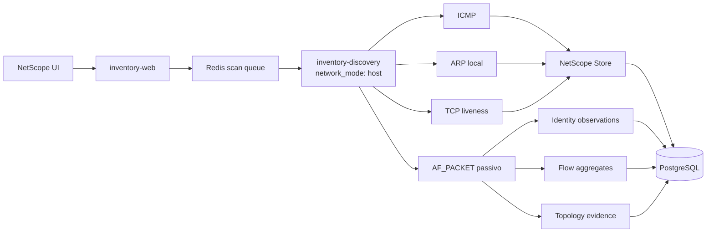

# NetScope — descoberta, disponibilidade e identidade

## 1. Objetivo

Este documento descreve a camada de descoberta do NetScope após a refatoração.

A implementação foi desenhada para resolver quatro classes de erro:

1. scan executado no namespace de rede errado;
2. host online classificado como offline apenas por falha de ping;
3. IP usado como se fosse MAC;
4. registros divergentes entre processos/containers.

---

## 2. Arquitetura



---

## 3. Scan manual e periódico

### Manual

O botão Scan:

1. chama o web;
2. web publica job em Redis;
3. discovery faz claim;
4. scan ocorre com rede do host;
5. resultado é publicado no estado Redis;
6. UI consulta o status.

O container web não executa ARP.

### Periódico

`discovery_worker.py` também executa descoberta periódica conforme `NETSCOPE_DISCOVERY_INTERVAL`.

---

## 4. Fontes de disponibilidade

### ICMP

É a evidência mais simples, mas não é suficiente sozinha.

### ARP

É usada apenas quando a rede é diretamente alcançável em L2.

A interface é escolhida por:

```bash
ip -j -4 route get <IP>
```

Se existe next hop/gateway, ARP do alvo remoto não é tentado como prova do MAC remoto.

### TCP liveness

Para hosts já conhecidos, o NetScope tenta portas configuráveis.

Padrão:

```text
22,80,443,445,3389,5985,8080,8443,53
```

Variáveis:

```dotenv
NETSCOPE_TCP_LIVENESS_PORTS=22,80,443,445,3389,5985,8080,8443,53
NETSCOPE_TCP_LIVENESS_TIMEOUT=0.4
```

Conexão TCP concluída = evidência positiva.

Timeout/refused/filtered = resultado inconclusivo.

### Agente ativo

Quando um agente Wazuh está explicitamente ativo, essa informação também pode sustentar disponibilidade.

---

## 5. Estados

### online

Existe evidência positiva recente.

### unverified

O sistema não conseguiu comprovar a disponibilidade.

Não significa desligado.

### offline

Não deve ser produzido apenas por falha ICMP/ARP/TCP.

A distinção evita falsos offline em firewalls, IoT, hosts Windows e endpoints que filtram ping.

---

## 6. Identidade IP/MAC

### Regras

- MAC precisa obedecer formato físico válido;
- `ip:192.168.x.x` é identidade temporária, não MAC;
- IP nunca é copiado para o campo MAC;
- host ping-only pode existir sem MAC;
- um MAC real posteriormente observado atualiza a identidade de forma conservadora.

### Fontes

- ARP;
- Ethernet local;
- DHCPACK;
- next-hop;
- inventário SNMP/Wazuh/agente.

---

## 7. Proteção contra MAC de gateway atribuído ao host remoto

Cenário:

```text
Host remoto 192.168.10.20
        |
      router
        |
sensor 192.168.1.100
```

No segmento do sensor, um pacote do host remoto pode ter:

```text
IP origem:  192.168.10.20
MAC origem: MAC_DO_ROUTER
```

O coletor só associa MAC Ethernet diretamente ao IP se esse IP pertence a uma rede L2 confiável observada localmente.

Segmentos são obtidos da interface de captura.

Para TAP/SPAN sem IP:

```json
{
  "topology": {
    "passive_local_networks": ["192.168.1.0/24"]
  }
}
```

---

## 8. DHCPACK

A captura passiva interpreta DHCP apenas como identidade confirmada quando vê DHCPACK.

Dados aproveitados:

- IP concedido;
- MAC cliente;
- hostname;
- lease;
- instante;
- sensor.

DISCOVER e REQUEST não promovem identidade de posse do IP.

---

## 9. Reconciliação

MAC ausente pode ser preenchido automaticamente quando:

1. observação é recente;
2. confiança é alta;
3. existe uma única MAC candidata;
4. a MAC não pertence a outro dispositivo.

MAC existente nunca é sobrescrito automaticamente.

Conflito permanece para revisão.

---

## 10. Cache e consistência

O Store foi alterado para evitar divergência entre processos.

Mudanças:

- cache com expiração curta;
- leitura periódica do PostgreSQL;
- erro do banco não é convertido silenciosamente em lista vazia;
- `_flush()` não apaga linhas criadas por outros containers apenas por não estarem no cache local;
- atualização procura linha por MAC e UID;
- ping-only e ARP podem convergir no mesmo ativo.

---

## 11. Captura passiva

Módulo: `services/netscope_passive.py`.

Características:

- Linux AF_PACKET;
- raw socket;
- buffers limitados;
- sem persistência de pacote completo;
- flush periódico;
- promisc desabilitado por padrão.

Protocolos/campos:

- Ethernet;
- IPv4;
- IPv6 básico;
- TCP;
- UDP;
- ICMP;
- ARP;
- VLAN 802.1Q;
- DHCPACK.

---

## 12. Limitações

- sem TAP/SPAN, o host não enxerga todo o tráfego de um switch;
- ARP não atravessa roteadores;
- TCP fechado não prova host offline;
- MAC de próximo salto é L2 local, não necessariamente identidade do IP remoto;
- switches não gerenciáveis não revelam portas físicas.

---

## 13. Diagnóstico

### Rota

```bash
docker exec inventory_discovery ip -j -4 route get 192.168.10.14
```

### Ping

```bash
docker exec inventory_discovery ping -c 2 -W 1 192.168.10.14
```

### TCP

```bash
docker exec inventory_discovery python - <<'PY'
from services.netscope_reachability import probe_tcp
print(probe_tcp("192.168.10.14"))
PY
```

### Evidências

```sql
SELECT source, relation, COUNT(*)
FROM netscope_topology_evidence
WHERE active
GROUP BY source, relation
ORDER BY 1,2;
```

### Identidades

```sql
SELECT ip, mac, source, confidence, last_seen
FROM netscope_identity_observations
ORDER BY last_seen DESC;
```

---

## 14. Testes

Principais testes:

- `tests/test_netscope_liveness.py`;
- `tests/test_netscope_passive_topology.py`;
- `tests/test_netscope_topology_evidence.py`.

```bash
pytest -q tests/test_netscope_liveness.py \
          tests/test_netscope_passive_topology.py \
          tests/test_netscope_topology_evidence.py
```
