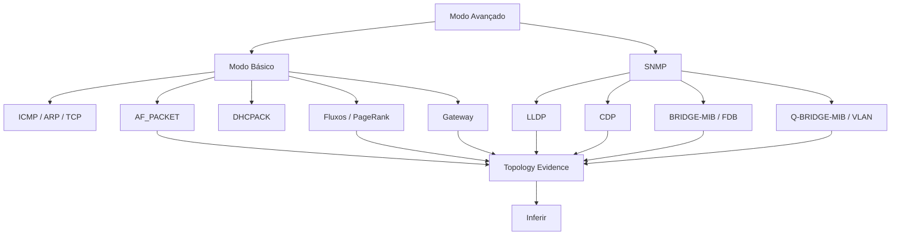

# NetScope — topologia e Inferir baseado em evidências

## 1. Objetivo

O NetScope não tenta mais representar todas as relações como se fossem cabos físicos.

O motor diferencia:

- comunicação;
- próximo salto;
- gateway;
- porta declarada;
- FDB provável;
- vizinhança física LLDP/CDP.

---

## 2. Modos



### Básico

Não exige switch gerenciável.

### Avançado

Exige somente para as fontes que se deseja usar. Se SNMP estiver desligado, o modo Básico continua funcional.

---

## 3. Tipos de evidência

| Relação | Significado |
| --- | --- |
| `physical-configured` | operador declarou uma porta |
| `physical-lldp` | vizinhança física LLDP |
| `physical-cdp` | vizinhança física CDP |
| `physical-fdb-candidate` | provável acesso derivado de FDB |
| `passive-next-hop` | MAC de próximo salto observado localmente |
| `logical-gateway` | relação L3 com gateway configurado |
| `l2-peer-observed` | dois IPs/MACs comunicaram no mesmo L2 observado |
| `fdb-learned` | MAC aprendida em determinada porta |
| `arp-presence` | presença observada via ARP |

---

## 4. Precedência

```text
manual
  >
LLDP/CDP forte
  >
porta explicitamente configurada
  >
FDB candidata
  >
próximo salto Ethernet
  >
gateway lógico
```

A implementação recusa empates fortes em vez de escolher arbitrariamente.

---

## 5. Vínculos manuais

São autoritativos.

O Inferir:

- não sobrescreve;
- não remove;
- usa vínculo manual para prevenção de ciclos.

---

## 6. LLDP/CDP

LLDP e CDP produzem `physical-neighbor`.

Dados registrados:

- observador;
- ativo local;
- peer;
- porta local;
- porta remota;
- nome/chassis remoto;
- confiança;
- first_seen;
- last_seen;
- expiração.

### Overlay

LLDP/CDP podem representar conexões que não cabem em árvore de pai único.

Por isso aparecem também como arestas overlay independentes de `parent_id`.

---

## 7. FDB

### Problema clássico

A presença:

```text
MAC X -> porta 24
```

não prova:

```text
Host X ---cabo---> porta 24
```

A porta pode ser:

- uplink;
- AP;
- bridge;
- telefone IP;
- hypervisor;
- outro switch.

### Política atual

Toda FDB vira primeiro `fdb-learned`.

Só vira `fdb-access-candidate` se:

- porta não identificada como uplink LLDP/CDP;
- apenas uma MAC relevante aprendida;
- MAC conhecida no inventário.

---

## 8. Fluxos e centralidade

O NetScope calcula localmente:

- peers;
- in-peers;
- out-peers;
- bytes;
- pacotes;
- fluxos;
- PageRank;
- clientes por porta.

Papéis:

### network-transit-candidate

Exige evidência de next-hop para múltiplos ativos.

### communication-centralizer

Usa número de peers e PageRank.

### dns-service

Baseado em vários clientes chegando à porta 53.

### dhcp-service

Baseado em vários clientes chegando ao serviço DHCP.

Nenhum desses papéis equivale a prova física.

---

## 9. Segurança do algoritmo

Proteções:

- prevenção de ciclos;
- conflito de parent forte;
- gateway duplicado rejeitado;
- porta manual duplicada rejeitada;
- evidência expirada ignorada;
- vínculo manual preservado;
- preview antes de aplicar;
- execução repetida tende a zero alterações.

---

## 10. Preview

O botão Inferir primeiro chama:

```json
{"preview": true}
```

Resumo retornado:

- modo;
- physical_configured;
- passive_next_hop;
- physical_advanced;
- logical_gateway;
- role_updates;
- manual_preserved;
- unresolved;
- conflicts;
- cycles_prevented;
- cleared;
- evidence.

Só após confirmação a UI envia:

```json
{"preview": false}
```

---

## 11. Representação visual

- lógico gateway: tracejado leve;
- próximo salto passivo: tracejado intermediário;
- LLDP/CDP/FDB avançado: estilo próprio;
- porta configurada: estilo próprio;
- popover exibe natureza/evidência;
- papéis inferidos aparecem separados.

---

## 12. Configuração

Objeto padrão:

```json
{
  "topology": {
    "mode": "basic",
    "passive_enabled": true,
    "passive_interface": "",
    "passive_local_networks": [],
    "promiscuous": false,
    "sensor_id": "",
    "flow_window_seconds": 300,
    "flow_analysis_minutes": 30,
    "flush_seconds": 15,
    "max_flow_keys": 5000,
    "evidence_ttl_seconds": 1800,
    "flow_retention_hours": 24,
    "identity_retention_days": 30,
    "advanced": {
      "lldp": true,
      "cdp": true,
      "fdb": true
    }
  }
}
```

---

## 13. SNMP avançado

Variáveis:

```dotenv
SNMP_ENABLED=true
SNMP_TARGETS_JSON=[]
SNMPWALK_BINARY=snmpwalk
```

Recomenda-se SNMPv3 somente leitura.

MIBs usadas:

- system;
- IF-MIB;
- BRIDGE-MIB;
- Q-BRIDGE-MIB;
- LLDP-MIB;
- CISCO-CDP-MIB quando disponível.

Falha de OID opcional não aborta toda a coleta.

---

## 14. Limitações

Mesmo no modo Avançado:

- FDB pode refletir aprendizado transitório;
- LLDP pode estar desligado;
- CDP é específico;
- equipamentos não gerenciáveis não expõem portas;
- TAP/SPAN determina a visibilidade da análise passiva;
- múltiplos caminhos L2 exigem modelo grafo, não apenas árvore.

---

## 15. Testes

- `tests/test_netscope_topology.py`;
- `tests/test_netscope_topology_modes.py`;
- `tests/test_snmp_source.py`;
- `tests/test_netscope_topology_evidence.py`.

```bash
pytest -q tests/test_netscope_topology.py \
          tests/test_netscope_topology_modes.py \
          tests/test_snmp_source.py \
          tests/test_netscope_topology_evidence.py
```
