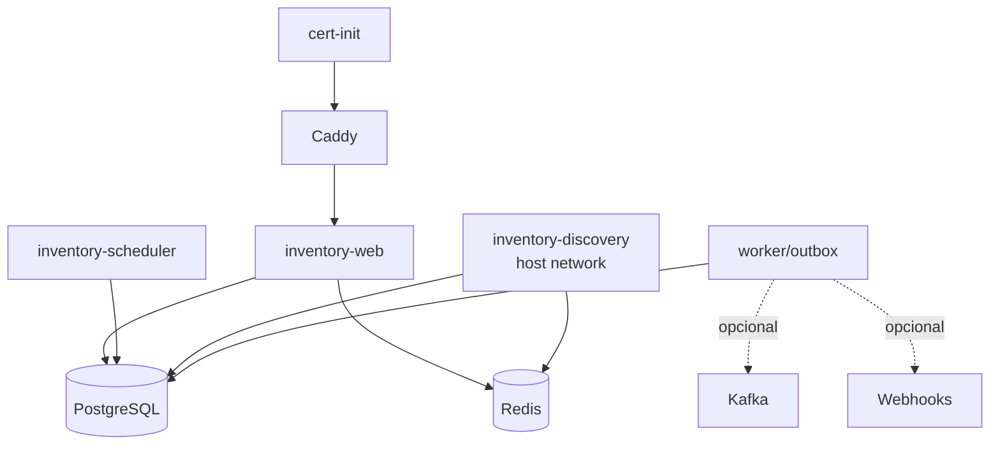

# Inventory — operação da arquitetura refatorada

## 1. Objetivo

Guia operacional para as funcionalidades adicionadas ao fork.

---

## 2. Serviços

Implantação típica:



---

## 3. Configuração inicial

```bash
cp .env.example .env
```

Preencher pelo menos:

- DB_PASS;
- credenciais administrativas;
- host TLS;
- fontes realmente usadas.

---

## 4. Wazuh opcional

Desligado:

```dotenv
WAZUH_ENABLED=false
NETSCOPE_SOURCE_ENABLED=true
```

Ligado:

```dotenv
WAZUH_ENABLED=true
WAZUH_HOST=
WAZUH_USER=
WAZUH_PASSWORD=
WAZUH_TLS_VERIFY=true
WAZUH_CA_BUNDLE=
```

---

## 5. Fontes opcionais

### Wazuh Indexer

```dotenv
WAZUH_INDEXER_ENABLED=false
```

### osquery

```dotenv
OSQUERY_ENABLED=false
OSQUERY_BINARY=osqueryi
```

### SNMP

```dotenv
SNMP_ENABLED=false
SNMP_TARGETS_JSON=[]
```

### SSH

```dotenv
SSH_SOURCE_ENABLED=false
SSH_STRICT_HOST_KEY=true
SSH_TARGETS_JSON=[]
```

### WinRM

```dotenv
WINRM_SOURCE_ENABLED=false
WINRM_TARGETS_JSON=[]
```

---

## 6. NetScope

### Discovery worker

```dotenv
NETSCOPE_SOURCE_ENABLED=true
NETSCOPE_BACKGROUND_ENABLED=true
NETSCOPE_DISCOVERY_INTERVAL=900
NETSCOPE_PASSIVE_INTERFACE=
NETSCOPE_TCP_LIVENESS_PORTS=22,80,443,445,3389,5985,8080,8443,53
NETSCOPE_TCP_LIVENESS_TIMEOUT=0.4
```

### Básico

Selecione pela UI:

```text
Básico — ativo + passivo local
```

### Avançado

```text
Avançado — + SNMP/LLDP/CDP/FDB
```

SNMP continua sendo explicitamente habilitado via ambiente.

---

## 7. Banco e migrations

Antes de atualização importante:

```bash
docker exec inventory_postgres \
  pg_dump -U inventorydb -d inventory_db -Fc \
  > inventory_backup.dump
```

Atualizar:

```bash
git pull
docker compose up -d --build --force-recreate \
  inventory-web inventory-discovery inventory-scheduler
```

Validar migration:

```bash
docker logs --tail=100 inventory_web
```

ou:

```bash
docker exec inventory_web alembic current
```

---

## 8. Eventos opcionais

Kafka não é requisito.

```bash
docker compose --profile events up -d
```

Sem profile events:

- Asset Core funciona;
- NetScope funciona;
- API funciona;
- dashboard funciona.

---

## 9. mTLS opcional

```bash
docker compose --profile mtls up -d
```

Utilizado para ingestão máquina-a-máquina quando desejado.

---

## 10. TLS local

`cert-init`:

- cria/repara certificado;
- valida SAN;
- verifica chave;
- renova antes da expiração.

Ver [TLS_LOCAL.md](TLS_LOCAL.md).

---

## 11. Health e validação

### Containers

```bash
docker compose ps
```

### Web

```bash
docker logs --tail=100 inventory_web
```

### Discovery

```bash
docker logs --tail=100 inventory_discovery
```

### Banco

```bash
docker exec inventory_postgres \
  psql -U inventorydb -d inventory_db -c "SELECT 1"
```

### NetScope evidence

```bash
docker exec inventory_postgres \
  psql -U inventorydb -d inventory_db -c "
SELECT source, relation, COUNT(*)
FROM netscope_topology_evidence
WHERE active
GROUP BY source, relation
ORDER BY 1,2;"
```

---

## 12. Validação de desenvolvimento

```bash
python -m compileall -q .
alembic upgrade head
pytest
docker compose config --quiet
```

O CI executa as mesmas classes de validação.

---

## 13. Rollback

### Código

Use um commit conhecido e faça recreate dos serviços.

### Banco

Não use:

```text
docker compose down -v
```

em ambiente com dados importantes.

Para rollback estrutural, prefira:

1. backup pg_dump;
2. código compatível;
3. migration downgrade apenas quando validada;
4. restore completo se necessário.

---

## 14. Troubleshooting NetScope

### Muitos unverified

Verifique:

- rota dentro do discovery;
- ping;
- TCP probe;
- interface passiva;
- firewall;
- evidências.

### Sem evidência passiva

```bash
docker exec inventory_discovery ip addr
docker exec inventory_discovery ip route
```

Se TAP/SPAN:

- configure interface correta;
- habilite promisc no topology config;
- defina `passive_local_networks` quando a interface não tem IP.

### Sem LLDP/CDP/FDB

Verifique:

- modo Advanced;
- `SNMP_ENABLED=true`;
- target SNMP;
- permissões read-only;
- MIB suportada pelo equipamento.

A ausência de CDP/LLDP não deve abortar a coleta SNMP inteira.

---

## 15. Segurança operacional

- use SNMPv3 quando possível;
- não exponha Redis/PostgreSQL sem necessidade;
- mantenha DB_PASS fora do Git;
- instale somente `ca.pem` nos clientes;
- nunca distribua `ca-key.pem`;
- não use MAC/IP inferidos como prova física sem consultar a evidência;
- não force estados online/offline diretamente no banco.

---

## 16. Documentos

- [REFATORACAO_FEATURES.md](REFATORACAO_FEATURES.md)
- [NETSCOPE_DISCOVERY_IDENTITY.md](NETSCOPE_DISCOVERY_IDENTITY.md)
- [NETSCOPE_TOPOLOGY_INFERENCE.md](NETSCOPE_TOPOLOGY_INFERENCE.md)
- [NETSCOPE_DATA_MODEL.md](NETSCOPE_DATA_MODEL.md)
- [IMPLEMENTACAO_COMPLETA_020.md](IMPLEMENTACAO_COMPLETA_020.md)
