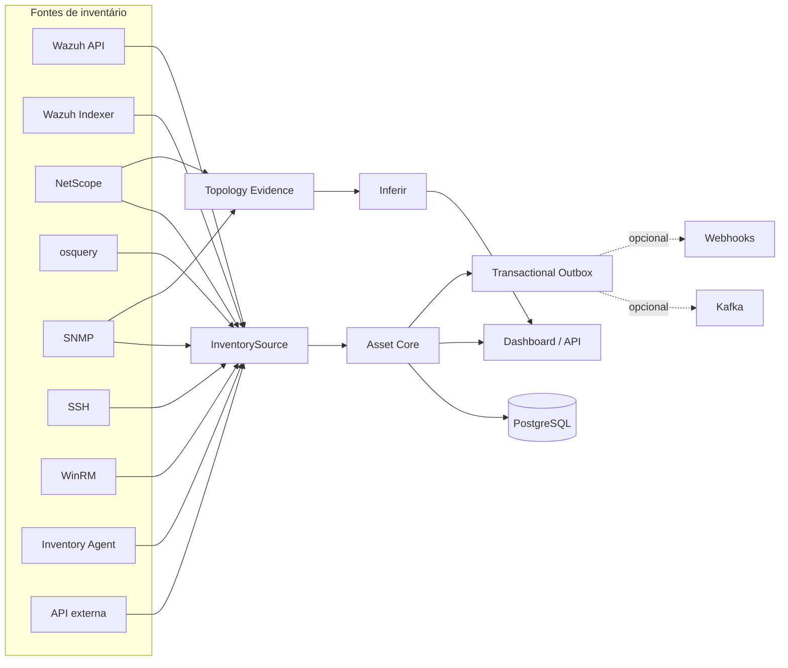
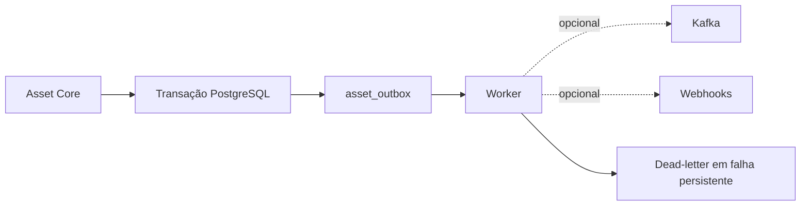
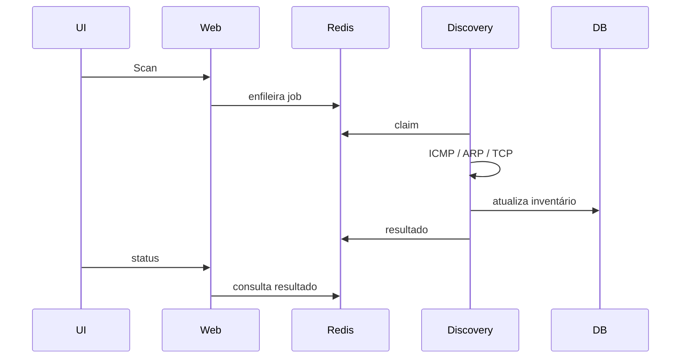

# Inventory — catálogo de funcionalidades adicionadas no fork

## Referência de comparação

Este documento registra as funcionalidades adicionadas ou estruturalmente refatoradas no fork `overcyber/Inventory` em relação ao repositório original `Maarckz/Inventory`.

Referências usadas na comparação:

- original: `Maarckz/Inventory@79be5e5e0f17f2851b7bac562d370df3b41e1945`;
- fork documentado: linha principal posterior à implementação do NetScope baseado em evidências;
- arquivos exclusivos do fork incluem Asset Core, migrations, microserviços, fontes multifuente, API, testes e novos módulos NetScope.

O objetivo é documentar **diferenças funcionais**, não apenas arquivos novos.

---

## 1. Visão geral



---

## 2. Asset Core multifuente

### 2.1 Identidade canônica

O fork introduz um modelo de ativo independente da origem dos dados.

Principais capacidades:

- UUID interno para o ativo;
- identificadores observados por fonte;
- estados separados por origem;
- resolução de identidade usando identificadores fortes;
- detecção de conflito quando um identificador aponta para múltiplos ativos;
- hostname e IP deixam de ser considerados identidade suficiente por si só.

Prioridade conceitual de identidade:

1. external-id estável da mesma fonte;
2. serial;
3. machine-id;
4. cloud instance id;
5. Wazuh agent id;
6. MAC não ambíguo;
7. hostname/IP somente como sinais auxiliares.

### 2.2 Proveniência e confiança

Cada fonte mantém seu próprio estado. O estado canônico é reconstruído preservando:

- fonte;
- external-id;
- instante da observação;
- confiança;
- dados raw;
- dados normalizados.

### 2.3 Histórico temporal

Foram adicionados:

- `asset_observations`;
- `asset_snapshots`;
- `asset_changes`;
- histórico de endereços;
- interfaces;
- hardware;
- software;
- processos;
- serviços;
- portas.

Itens que desaparecem deixam de ser apagados silenciosamente: podem ser marcados como inativos com `valid_to`.

---

## 3. Independência do Wazuh

O Wazuh deixou de ser uma dependência estrutural.

```dotenv
WAZUH_ENABLED=false
NETSCOPE_SOURCE_ENABLED=true
```

Com Wazuh desabilitado, continuam disponíveis:

- PostgreSQL e Redis;
- NetScope;
- Asset Core;
- osquery;
- SNMP;
- SSH;
- WinRM;
- Inventory Agent;
- API de ingestão;
- dashboard;
- busca;
- relatórios;
- notificações;
- eventos opcionais.

O modelo legado `HostInventory` permanece para compatibilidade e backfill controlado.

---

## 4. Fontes adicionais

### 4.1 Wazuh API

Mantida como fonte, com:

- paginação;
- paralelismo controlado;
- TLS verificável;
- CA configurável;
- status de agente separado de disponibilidade de rede.

### 4.2 Wazuh Indexer

Fonte opcional para consumir dados indexados sem depender exclusivamente da API Manager.

### 4.3 NetScope

Integra descoberta de rede com o Asset Core e mantém topologia própria.

### 4.4 osquery

Suporte de ingestão via `osqueryi` para inventário local/automatizado.

### 4.5 SNMP

Suporte a:

- SNMP v2c;
- SNMPv3;
- interfaces;
- MAC;
- estado de interface;
- VLAN;
- FDB;
- LLDP;
- CDP;
- Q-BRIDGE-MIB.

### 4.6 SSH

Coleta remota de:

- hostname;
- machine-id;
- interfaces;
- software;
- processos;
- serviços;
- usuários;
- serial;
- portas.

### 4.7 WinRM

Inventário remoto Windows como fonte independente.

### 4.8 Inventory Agent

Agente próprio opcional com:

- unit systemd;
- arquivo de ambiente;
- ingestão via endpoint autenticado.

### 4.9 API externa

Permite ingestão de observações manual/batch e integração com sistemas externos.

---

## 5. API e autenticação máquina-a-máquina

Novos recursos:

- API Asset Core;
- listagem de ativos;
- consulta por UUID;
- listagem de fontes;
- ingestão de observações;
- disparo de sincronização;
- tokens de ingestão;
- separação entre autenticação de usuário e máquina;
- controles de CSRF/RBAC onde aplicável.

Contrato: [openapi.yaml](openapi.yaml).

---

## 6. Eventos e integrações opcionais

O núcleo não depende de Kafka.

Foi adicionado:

- outbox transacional;
- estado pending/published;
- tentativas;
- retry persistente;
- dead-letter;
- tópico `asset.snapshot.v1`;
- webhooks;
- perfil Docker opcional de eventos.



---

## 7. Microserviços e Docker

O fork adiciona uma implantação containerizada separando responsabilidades:

- `inventory-web`;
- `inventory-scheduler`;
- `inventory-discovery`;
- worker/outbox;
- PostgreSQL;
- Redis;
- Caddy;
- `cert-init`;
- Kafka opcional;
- endpoint mTLS opcional.

### Separação de privilégios

A descoberta ativa fica isolada do web:

- web sem necessidade de `NET_RAW`;
- discovery com rede do host;
- descoberta L2/ARP executada no worker apropriado;
- comunicação de scan manual por Redis.

---

## 8. Scheduler, resiliência e health

O fork adiciona execução desacoplada das fontes por scheduler.

Características:

- fontes podem ser habilitadas/desabilitadas independentemente;
- erro em uma fonte não precisa interromper todas as demais;
- scheduler roda separado do web;
- discovery roda separado do scheduler geral;
- health/readiness podem refletir dependências operacionais;
- testes cobrem resiliência Wazuh, TLS e source scheduler.

O objetivo é impedir que indisponibilidade de Wazuh, SNMP ou outra integração torne toda a aplicação inutilizável.

---

## 9. Ingestão mTLS opcional

Foi adicionado perfil opcional para ingestão máquina-a-máquina protegida por certificado.

```bash
docker compose --profile mtls up -d
```

O mTLS é complementar ao token de ingestão e não é requisito para o uso normal da interface.

---

## 10. Robustez de rede e portscan

Além da nova disponibilidade multiprotocolo do NetScope, o fork adiciona/reforça:

- utilitários de CIDR compartilhados;
- limite de hosts por rede;
- processamento em lotes;
- portscan com paralelismo limitado;
- proteção contra esgotamento de file descriptors;
- testes de perfis TCP/UDP;
- separação entre liveness TCP e varredura completa de portas.

---

## 11. Alembic e evolução do schema

Adicionado:

- `alembic.ini`;
- ambiente Alembic;
- migrations versionadas;
- migration do Asset Core;
- migration da plataforma;
- migration de sessões;
- migration de evidências/topologia NetScope;
- validação de idempotência em CI.

```bash
alembic upgrade head
```

---

## 12. TLS local

Foi adicionada uma PKI local para HTTPS interno:

- CA local;
- certificado servidor;
- renovação antecipada;
- validação SAN/IP;
- verificação da correspondência chave/certificado;
- `cert-init`;
- scripts de instalação da CA em Linux, Windows e macOS.

Documentação: [TLS_LOCAL.md](TLS_LOCAL.md).

---

## 13. NetScope — descoberta refatorada

### 10.1 Scan no namespace correto

O scan manual não roda mais no container web em bridge.

Fluxo atual:



### 10.2 Disponibilidade multiprotocolo

Um host pode ser confirmado online por:

- ICMP;
- ARP local;
- conexão TCP;
- agente Wazuh ativo.

Falha de ping não é prova de indisponibilidade.

Estados relevantes:

- `online`: há evidência positiva;
- `unverified`: não foi possível confirmar;
- `offline`: reservado para evidência explícita quando aplicável.

### 10.3 TCP liveness

Portas padrão configuráveis:

- 22;
- 80;
- 443;
- 445;
- 3389;
- 5985;
- 8080;
- 8443;
- 53.

A sondagem é limitada a IPs conhecidos.

### 10.4 ARP baseado em rota

A interface de ARP é selecionada pela rota real do sistema.

O NetScope não tenta resolver MAC remoto por ARP através de um roteador.

---

## 14. NetScope — proteção de identidade MAC/IP

Correções adicionadas:

- IP nunca é armazenado como MAC;
- identificadores `ip:...` não são promovidos a endereço físico;
- ping-only não cria um MAC falso;
- MAC de tráfego roteado não é atribuído a host de outra sub-rede;
- MAC existente não é sobrescrito automaticamente;
- observações conflitantes não são resolvidas arbitrariamente;
- MAC ausente só é preenchido quando existe uma única observação recente de alta confiança.

Fontes de identidade:

- ARP;
- Ethernet local;
- DHCPACK;
- próximo salto;
- fontes de inventário.

---

## 15. NetScope — cache e concorrência

O Store original possuía cache por processo que podia ficar indefinidamente desatualizado.

A refatoração inclui:

- TTL curto de cache;
- refresh entre processos;
- falha de banco não vira silenciosamente inventário vazio;
- remoção da exclusão destrutiva de linhas ausentes no cache local;
- reconciliação por IP/MAC para evitar duplicações de descoberta;
- preservação de registros criados por outros containers.

---

## 16. NetScope — captura passiva local

O modo Básico ganhou um observador local independente do AEGIS.

Implementação:

- Linux `AF_PACKET`;
- sem Scapy obrigatório;
- sem Kafka;
- sem PCAP persistido;
- buffers limitados;
- flush periódico de agregados.

Campos observados:

- MAC origem/destino;
- IPv4/IPv6;
- TCP/UDP/ICMP;
- VLAN 802.1Q;
- ARP;
- DHCPACK;
- interface;
- sensor_id;
- bytes/pacotes.

### Segurança de observabilidade

O MAC Ethernet só é associado diretamente a um IP quando o endereço pertence ao segmento L2 confiável do sensor.

Para TAP/SPAN sem IP local, `topology.passive_local_networks` pode definir explicitamente os segmentos observados.

---

## 17. NetScope — agregados de fluxo e centralidade

Foram adicionados agregados locais:

- src/dst IP;
- src/dst MAC;
- src/dst porta;
- protocolo;
- VLAN;
- bytes;
- pacotes;
- contagem de fluxos;
- janela temporal.

A análise calcula:

- peers únicos;
- in-peers;
- out-peers;
- bytes;
- pacotes;
- fluxos;
- PageRank;
- clientes por porta de serviço.

Papéis inferidos possíveis:

- `network-transit-candidate`;
- `communication-centralizer`;
- `dns-service`;
- `dhcp-service`.

Centralidade é evidência funcional, não prova de cabeamento.

---

## 18. NetScope — modos Básico e Avançado

### Básico

Funciona sem switch gerenciável.

Usa:

- ICMP;
- ARP;
- TCP;
- DHCPACK;
- Ethernet local;
- fluxos;
- centralidade;
- gateway configurado.

### Avançado

Inclui tudo do Básico e acrescenta:

- SNMP;
- LLDP;
- CDP;
- BRIDGE-MIB;
- Q-BRIDGE-MIB;
- FDB;
- VLAN;
- bridge-port → ifIndex.

---

## 19. NetScope — FDB segura

A FDB não cria mais diretamente `switch_port`.

Toda leitura vira evidência.

Uma entrada pode ser promovida a candidato de porta de acesso somente quando:

1. a porta não é reconhecida como uplink LLDP/CDP;
2. há uma única MAC relevante na porta na janela;
3. a MAC corresponde a um ativo conhecido.

FDB permanece com confiança inferior a LLDP/CDP.

---

## 20. NetScope — Inferir baseado em evidências

Prioridade:

1. vínculo manual;
2. LLDP/CDP forte;
3. porta de switch explicitamente configurada;
4. candidato FDB;
5. próximo salto Ethernet passivo;
6. gateway lógico.

Proteções:

- manual nunca é sobrescrito;
- ciclos são bloqueados;
- empates fortes são rejeitados;
- gateway duplicado não vira pai;
- múltiplas portas configuradas para o mesmo dispositivo geram ambiguidade;
- preview obrigatório antes de aplicar pela UI;
- relações antigas sem evidência podem ser removidas;
- execução idempotente.

---

## 21. Topologia multiperspectiva

O fork diferencia:

- **físico observado**: LLDP/CDP;
- **físico declarado**: porta configurada manualmente;
- **L2 provável**: FDB candidata;
- **próximo salto observado**: Ethernet passivo;
- **L3 lógico**: gateway;
- **comunicação**: fluxos;
- **papel funcional**: centralidade/serviço.

Isso evita apresentar comunicação ou centralidade como cabo físico.

---

## 22. Persistência NetScope adicional

Novas tabelas:

- `netscope_topology_evidence`;
- `netscope_flow_aggregates`;
- `netscope_identity_observations`.

Detalhes: [NETSCOPE_DATA_MODEL.md](NETSCOPE_DATA_MODEL.md).

---

## 23. Interface NetScope

Adicionado:

- seletor Básico/Avançado;
- status do coletor passivo;
- quantidade de evidências;
- contagem LLDP/CDP/FDB;
- preview detalhado do Inferir;
- exibição da natureza da evidência;
- papéis inferidos;
- estilos diferentes para relações lógicas, passivas e físicas;
- overlay LLDP/CDP independente do `parent_id`.

---

## 24. Testes e CI

Arquivos exclusivos do fork incluem uma suíte cobrindo:

- Asset Core;
- identidade;
- integração multifuente;
- migrations;
- MFA;
- segurança;
- NetScope liveness;
- NetScope topology;
- captura passiva;
- evidências;
- modos Básico/Avançado;
- SNMP;
- source scheduler;
- Wazuh resilience/TLS;
- portscan.

Pipeline:

1. instala dependências;
2. compila Python;
3. migra PostgreSQL limpo;
4. verifica idempotência da migration;
5. valida TLS bootstrap;
6. valida Docker Compose;
7. roda pytest;
8. CodeQL em workflow separado.

---

## 25. Compatibilidade

Recursos legados foram mantidos sempre que possível.

Compatibilidade relevante:

- Wazuh continua suportado;
- `HostInventory` continua disponível durante transição;
- NetScope continua funcionando no modo Básico sem SNMP;
- Kafka continua opcional;
- relações manuais do NetScope continuam prioritárias;
- tabelas existentes não são removidas pela migration de topologia.

---

## 26. Documentos relacionados

- [ARCHITECTURE_ASSET_CORE.md](ARCHITECTURE_ASSET_CORE.md)
- [IMPLEMENTACAO_COMPLETA_020.md](IMPLEMENTACAO_COMPLETA_020.md)
- [NETSCOPE_DISCOVERY_IDENTITY.md](NETSCOPE_DISCOVERY_IDENTITY.md)
- [NETSCOPE_TOPOLOGY_INFERENCE.md](NETSCOPE_TOPOLOGY_INFERENCE.md)
- [NETSCOPE_DATA_MODEL.md](NETSCOPE_DATA_MODEL.md)
- [OPERACAO_REFATORADA.md](OPERACAO_REFATORADA.md)
- [TLS_LOCAL.md](TLS_LOCAL.md)
- [openapi.yaml](openapi.yaml)
